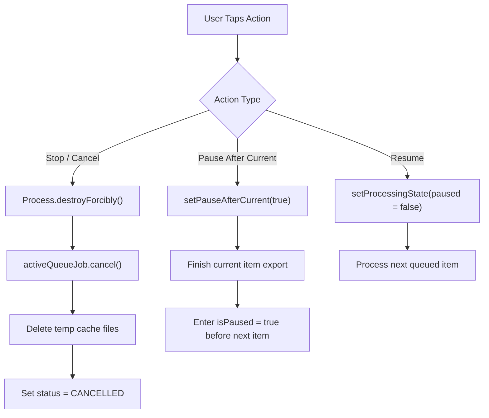

<p align="center">
  <a href="https://ko-fi.com/todd0042">
    
  </a>
</p>

---

# 🔊 Deciflux — Android Video Audio Normalizer (Jetpack Compose Mobile Touch GUI)

[](https://github.com/Todd0042/deciflux/releases)
[](LICENSE)
[-D0BCFF.svg)](https://github.com/Todd0042/deciflux/releases)
[](https://github.com/Todd0042/deciflux/releases)
[]()
[]()
[]()
[](https://ko-fi.com/todd0042)

> **Deciflux is a modern native Android touch GUI app built with Jetpack Compose and Material 3 for high-speed, professional batch video audio normalization. Re-encodes audio tracks to broadcast loudness standards (EBU R128 / ITU-R BS.1770) or scene-by-scene dynamic leveling with zero video re-encoding (`-c:v copy`), running up to 30x realtime directly on your device with 100% offline privacy.**

---

## 📖 Table of Contents

* **Part 1 — User Overview & Quick Start**
  * [⚡ What Is Deciflux?](#-what-is-deciflux)
  * [🎯 Real-World Use Cases](#-real-world-use-cases)
  * [🎬 How It Works in 3 Steps](#-how-it-works-in-3-steps)
  * [✨ Feature Highlights at a Glance](#-feature-highlights-at-a-glance)
  * [📱 Visual Design & Terminal Console](#-visual-design--terminal-console)
  * [🚀 Download & Installation](#-download--installation)
* **Part 2 — Technical Architecture & Engine Reference**
  * [1. Zero Video Loss Passthrough Engine (`-c:v copy`)](#1-zero-video-loss-passthrough-engine--cv-copy)
  * [2. Dual-Pass EBU R128 Loudness Normalization (`loudnorm`)](#2-dual-pass-ebu-r128-loudness-normalization-loudnorm)
  * [3. Scene-Aware Dynamic Audio Leveling (`dynaudnorm`)](#3-scene-aware-dynamic-audio-leveling-dynaudnorm)
  * [4. Modern Android Background Resilience & Power Policy](#4-modern-android-background-resilience--power-policy)
  * [5. Batch Pipeline, Graceful Pause & Immediate Process Kill](#5-batch-pipeline-graceful-pause--immediate-process-kill)
  * [6. Scoped Storage Intake & Safe Replacement Strategy](#6-scoped-storage-intake--safe-replacement-strategy)
  * [7. Pre-Flight Storage Capacity Safeguards](#7-pre-flight-storage-capacity-safeguards)
  * [8. Defensive Security & Path Sanitization Architecture](#8-defensive-security--path-sanitization-architecture)
  * [9. Universal Native Packaging & Android Linker Configuration](#9-universal-native-packaging--android-linker-configuration)
  * [10. Codebase Architecture & File Map](#10-codebase-architecture--file-map)
  * [11. Building from Source](#11-building-from-source)

---

# Part 1 — User Overview & Quick Start

## ⚡ What Is Deciflux?

Have you ever queued up home videos, downloaded social clips, recorded tutorials, or watched a playlist of videos where one track is whisper-quiet and the next blares through your phone speaker or headphones?

**Deciflux** solves uneven video audio on Android without degrading video quality or requiring a desktop computer:
1. **100% Lossless Video Passthrough**: Your video bitstream (H.264, HEVC, AV1, VP9, etc.) is never touched or re-compressed. FFmpeg passes video frames through with `-c:v copy`, completing a 10-minute 1080p video in just ~20 seconds at **25x–30x realtime speed** (`~750 fps`).
2. **Industry-Standard Loudness**: Choose broadcast and social presets (-14 LUFS for YouTube/Social, -16 LUFS for Podcasts, -23 LUFS for European EBU Broadcast, or -15 LUFS Dialogue Boost).
3. **Intelligent Scene-by-Scene Normalization**: Toggle on dynamic scene leveling to smooth out abrupt volume jumps between scenes while keeping natural cinematic contrast.
4. **Embedded Terminal Console**: Monitor telemetry live right on the main screen—integrated loudness, true peak, loudness range (LRA), frame count, processing speed multiplier, and ETA—with zero intrusive pop-ups.
5. **Rock-Solid Background Resilience**: Normalized hundreds of videos in the background while your phone is locked or while you switch between apps.

---

## 🎯 Real-World Use Cases

| User Persona & Scenario | The Challenge | How Deciflux Solves It | Recommended Preset & Settings |
| :--- | :--- | :--- | :--- |
| **📱 Social Media Creators (YouTube, TikTok, Reels, Shorts)** | Mobile vloggers and creators shoot multiple clips across varying environments (windy outdoor streets, quiet rooms, noisy cafes). When combined into a playlist or uploaded, volume varies wildly, causing viewers to manually adjust their volume or scroll away. | Batches dozens of short clips in seconds. Normalizes integrated loudness strictly to the standard **-14 LUFS** platform delivery ceiling with a **-1.0 dBTP** true peak safeguard, ensuring your clips play at maximum commercial volume without being penalized or crushed by platform loudness limiters. | **YouTube & Social** (`-14 LUFS`, `-1.0 dBTP`, `LRA 11.0 LU`)<br>• Codec: `AAC @ 192k`<br>• Scene Leveling: *Optional* |
| **🎙️ Mobile Podcasters & Video Interviewers** | Multi-speaker interviews or remote video recordings where one speaker sits further from the microphone or speaks much quieter than an assertive host. | The **Scene-Aware Dynamic Leveler (`dynaudnorm`)** analyzes local RMS windows and dynamically elevates quiet speech passages without exaggerating room noise during silent breaks. | **Streaming & Podcasts** or **Dialogue Boost** (`-15` or `-16 LUFS`)<br>• Scene Leveling: **Balanced** (`1200ms` window, `+10 dB` max gain) |
| **🎬 Cinematic Vloggers & Drone Cinematographers** | 4K 60fps / 10-bit HDR video files captured on DJI drones, GoPros, or mirrorless cameras contain huge video bitrates. Transcoding video on a phone would take hours and wash out color metadata. | **Zero Video Re-encoding (`-c:v copy`)** passes through 4K/HEVC/10-bit video packets untouched with bit-for-bit fidelity, completing a 10-minute clip in ~20 seconds without thermal throttling or color loss. | **YouTube & Social** (`-14 LUFS`)<br>• Scene Leveling: **Subtle** (`2000ms` window, preserving cinematic dynamic contrast) |
| **📺 Movie & TV Show Enthusiasts (Action vs Dialogue)** | Action movies played over phone speakers or Bluetooth headphones where whispers and dialogue require turning volume up to 100%, followed by deafening explosions or gunshots that hurt your ears. | **Consistent Scene Leveling** acts as an intelligent real-time audio leveling compressor, tightening loudness range ($LRA$) down to comfortable listening margins so you can hear whispers clearly without getting blasted during action scenes. | **Custom Tuner** (`-16 LUFS`)<br>• Scene Leveling: **Consistent** (`800ms` window, `+14 dB` max gain) |
| **📚 Online Course Instructors & Tutorial Lecturers** | Hours of screen recordings, lectures, and software tutorials recorded over several weeks with slight differences in microphone distance, input gain, or background room acoustics. | Drop entire course directories into Deciflux with the recursive **Folder Scanner**. Queue hundreds of lessons overnight, enabling **Replace Original Files** to clean up the library automatically with zero storage bloat. | **Dialogue Boost** (`-15 LUFS`, `-1.0 dBTP`, `LRA 8.0 LU`)<br>• Replace Original Files: **ON** |
| **📁 Archival Collectors & Video Library Curators** | Organizing thousands of legacy video clips, concert bootlegs, or home video archives with random volume levels ranging from -38 LUFS to -6 LUFS. | Run massive 500+ video queues in the background. The **Pre-Flight Storage Safeguard** validates free disk capacity before every file, while the **Partial WakeLock** keeps processing running continuously overnight with the phone locked. | Any Preset matching target media library<br>• Graceful pause & resume on demand |

---

## 🎬 How It Works in 3 Steps

1. **Select Videos**: Tap **Single**, **Files**, or pick an entire directory with **Folder** (using the Android Storage Access Framework recursive tree scanner).
2. **Select Loudness & Scene Leveling**: Choose an industry preset (e.g., `-14 LUFS` for YouTube/Social) and optionally toggle **Scene-by-Scene Dynamic Leveling** (`Subtle`, `Balanced`, `Consistent`, or `Custom`).
3. **Tap Start**: Deciflux spins up a Foreground Processing Service, shows live streaming telemetry in the embedded terminal console, and saves verified outputs directly to `Movies/Deciflux` in your Android gallery (or replaces originals upon completion).

---

## ✨ Feature Highlights at a Glance

* **🎯 2-Pass EBU R128 Loudness Processing**: Analyzes integrated loudness ($I$), true peak ($TP$), loudness range ($LRA$), and dynamic threshold in Pass 1, then applies precise linear gain offsets in Pass 2.
* **🌊 Scene-by-Scene Leveling Toggle**: Smooths sudden quiet dialogue followed by loud action using Gaussian-windowed dynamic leveling (`dynaudnorm`), preserving subtle dynamics without harsh clipping.
* **⏩ 25x–30x Realtime Throughput**: Because video packets are remuxed rather than transcoded, processing is limited only by storage I/O and audio DSP speed.
* **⏯️ Graceful "Pause After Current" & Immediate Stop**:
  * Tap **Pause** while processing to finish the current video cleanly and pause before the next.
  * Tap **Stop** to immediately terminate the running native FFmpeg process without waiting.
* **🛡️ Pre-Flight Storage Safeguard**: Checks available storage via `StatFs` before each file in the queue. Requires input file size plus a **250 MB safety margin**, skipping files if disk space is low instead of crashing the batch.
* **♻️ Optional "Replace Original Files" Mode**: Transactional safe delete: the original file is removed only after the normalized copy is fully written, validated, and indexed in MediaStore.
* **📺 Real-Time Terminal View**: Dark obsidian embedded console styled with syntax highlighting (`[ANALYSIS]`, `[REMUX]`, `[SCENE]`, `[SUCCESS]`, `[WARN]`, `[ERROR]`), auto-scroll, and 1-tap clipboard log export.
* **🔒 100% Offline & Private**: Zero analytics, zero ad SDKs, zero cloud dependencies. All DSP and remuxing executes entirely on-device.

---

## 📱 Visual Design & Terminal Console

Deciflux is built with Jetpack Compose Material 3 following a sleek dark obsidian aesthetic (`#121316`) accented with Electric Cyan (`#7CD4FD`), Emerald Peak (`#6EE7B7`), and Luminous Violet (`#D0BCFF`):

* **Top Bar**: Displays batch count, active processing ring indicator, 1-tap permissions wizard, and battery optimization dialog.
* **Intake Shelf**: Compact outlined action chips for Single file, Multi-file, and Directory tree intake.
* **Queue Cards**: Individual video cards showing resolution/container tags, file size, duration, interactive progress bar, before/after LUFS badges, and an instant preview player button.
* **Bottom Dock**: Real-time preset summary pill, graceful pause/resume buttons, and immediate stop button.
* **Embedded Terminal**: Real-time FFmpeg stdout/stderr telemetry parser displaying current FPS, encoding bitrate, speed multiplier, and ETA counter.

---

## 🚀 Download & Installation

Download the latest pre-compiled signed APK directly from the [Deciflux GitHub Releases](https://github.com/Todd0042/deciflux/releases):

1. Download **`deciflux-v1.0.0.apk`** to your Android device.
2. Open the downloaded file and confirm installation when prompted by Android Package Installer.
3. Launch **Deciflux** and complete the quick 4-step setup walkthrough.

> [!NOTE]
> Compatible with **Android 8.0 (Oreo / API 26) through Android 15 / 16 Beta (API 35/36)** across all major mobile architectures (`arm64-v8a`, `armeabi-v7a`, `x86`, `x86_64`).

---

# Part 2 — Technical Architecture & Engine Reference

## 1. Zero Video Loss Passthrough Engine (`-c:v copy`)

Traditional video converters transcode both video and audio streams simultaneously, which causes generational image quality loss, consumes heavy battery power, generates thermal throttling, and takes minutes per file.

Deciflux splits the pipeline into audio-only processing with bitstream video passthrough:
```bash
ffmpeg -y -hide_banner \
  -i /path/to/input.mp4 \
  -c:v copy \
  -af <filter_chain> \
  -c:a aac -b:a 192k \
  -avoid_negative_ts make_zero \
  -max_muxing_queue_size 2048 \
  /path/to/output.mp4
```
- `-c:v copy`: Reads compressed NAL units directly from the demuxer and writes them into the output muxer without decoding or re-encoding a single video frame.
- `-avoid_negative_ts make_zero`: Corrects container timestamps without introducing audio/video desynchronization.
- `-max_muxing_queue_size 2048`: Prevents muxer buffer underruns during high-throughput burst writes.

---

## 2. Dual-Pass EBU R128 Loudness Normalization (`loudnorm`)

Deciflux follows ITU-R BS.1770 / EBU R128 international loudness metering:

### Pass 1: Analysis
```bash
ffmpeg -hide_banner -nostats -i input.mp4 \
  -af loudnorm=I=-14.0:TP=-1.0:LRA=11.0:print_format=json \
  -vn -sn -dn -f null -
```
Pass 1 reads only the audio stream (`-vn -sn -dn`), evaluates integrated loudness ($I$), true peak ($TP$), loudness range ($LRA$), and dynamic threshold, outputting structured JSON telemetry:
```json
{
  "input_i": "-34.02",
  "input_tp": "-8.91",
  "input_lra": "22.90",
  "input_thresh": "-44.15",
  "target_offset": "0.02"
}
```

### Pass 2: Linear Normalization
Pass 2 applies the exact measured parameters to prevent dynamic compression artifacts:
```bash
-af loudnorm=I=-14.0:TP=-1.0:LRA=11.0:measured_I=-34.02:measured_TP=-8.91:measured_LRA=22.90:measured_thresh=-44.15:offset=0.02:linear=true
```
Setting `linear=true` ensures that if the required gain offset does not cause true-peak clipping, the normalization acts as pure linear gain adjustment without altering original audio dynamics.

---

## 3. Scene-Aware Dynamic Audio Leveling (`dynaudnorm`)

When the user activates **Scene-by-Scene Normalization**, Deciflux prepends the Dynamic Audio Normalizer (`dynaudnorm`) filter ahead of `loudnorm`:

$$\text{FilterChain} = \text{dynaudnorm}(f=\text{frameLen}, g=\text{gaussSize}, m=\text{maxGain}, p=0.95, r=0.6) \longrightarrow \text{loudnorm}(\text{linear}=\text{true})$$

| Intensity Level | Window Length ($f$) | Gaussian Size ($g$) | Max Gain ($m$) | Profile Description |
| :--- | :---: | :---: | :---: | :--- |
| **Subtle** | `2000 ms` | `45` | `+6 dB` | Gently softens abrupt volume jumps; preserves wide cinematic dynamics |
| **Balanced (Default)** | `1200 ms` | `31` | `+10 dB` | Natural dialogue boost with comfortable volume leveling |
| **Consistent** | `800 ms` | `21` | `+14 dB` | Brings quiet whispers up close to loud scenes; ideal for phone speakers |
| **Custom...** | User-defined | Configurable | `+6` to `+18 dB` | Granular slider control over leveling strength (10% – 100%) |

The Gaussian smoothing window ensures that gain changes transition seamlessly between scenes without noticeable pumping or breathing artifacts.

---

## 4. Modern Android Background Resilience & Power Policy

To ensure 600+ video batches process reliably overnight:
1. **Foreground Service with Modern Types**:
   - `FOREGROUND_SERVICE_TYPE_MEDIA_PROCESSING` on Android 14+ (API 34+).
   - `FOREGROUND_SERVICE_TYPE_DATA_SYNC` on Android 10–13.
2. **Partial CPU WakeLock**:
   - `PowerManager.PARTIAL_WAKE_LOCK` held with a 4-hour safety timeout to prevent the device CPU from entering deep sleep when the screen turns off.
3. **Battery Optimization Whitelisting**:
   - Direct intent integration (`Settings.ACTION_REQUEST_IGNORE_BATTERY_OPTIMIZATIONS`) to prevent manufacturer-specific background task killers (Samsung, Pixel, Xiaomi) from terminating long queues.

---

## 5. Batch Pipeline, Graceful Pause & Immediate Process Kill

The execution pipeline handles user interruptions cleanly without leaving zombie processes or corrupted video files:



- **Immediate Stop**: Calls `process.destroyForcibly()` directly on the active FFmpeg child PID, unlinks temporary cache files, cancels the Kotlin coroutine job, and stops the foreground service.
- **Graceful Pause**: Sets `pauseAfterCurrent = true`. The active file finishes pass 2 and exports to MediaStore, after which the service enters a paused state without starting the next item.

---

## 6. Scoped Storage Intake & Safe Replacement Strategy

Android 11+ enforces strict Scoped Storage permissions that prevent external subprocesses from accessing arbitrary filesystem paths or file descriptors directly.

### Cached Input Pipeline
1. Incoming `content://` URIs from SAF or MediaStore are streamed into a temporary cache file in `context.cacheDir` using a 128 KB buffer.
2. The child FFmpeg subprocess receives direct POSIX file path access (`/data/user/0/com.example.deciflux/cache/input_stream_*.mp4`).
3. Upon completion or failure, the cached input file is unlinked immediately in a `finally` block.

### Transactional File Replacement
When **"Replace Original Files"** is enabled:
1. The normalized output is written to a temporary cache file.
2. Output integrity and file size are verified (`length > 0L`).
3. The normalized video is committed into the user's MediaStore `Movies/Deciflux` collection with `IS_PENDING = 0`.
4. **Only after successful commitment** is the original file deleted via `DocumentsContract.deleteDocument()` or `ContentResolver.delete()`. If Android denies deletion permissions, the normalized video remains safely stored in MediaStore and a notice is logged to the console.

---

## 7. Pre-Flight Storage Capacity Safeguards

To prevent running out of storage mid-batch:
- Prior to launching Pass 1 for any video, Deciflux queries `StatFs` on `context.cacheDir`:
  ```kotlin
  val stat = StatFs(context.cacheDir.absolutePath)
  val availableBytes = stat.availableBytes
  val safetyMargin = 250L * 1024L * 1024L // 250 MB
  val hasEnough = availableBytes > (item.sizeBytes + safetyMargin)
  ```
- If free storage is insufficient, Deciflux marks the video as skipped (`"Insufficient storage space: X MB free, requires ~Y MB"`), logs an `[ERROR]` tag to the terminal console, and proceeds safely to the next file without aborting the entire queue.

---

## 8. Defensive Security & Path Sanitization Architecture

Deciflux implements defensive validation and path traversal mitigations throughout the processing pipeline:

1. **Explicit Permission Boundary Checks**: The `PermissionChecker` utility inspects runtime permissions (`READ_MEDIA_VIDEO` / `READ_EXTERNAL_STORAGE` and `POST_NOTIFICATIONS`) prior to initiating batch execution.
2. **Path Traversal & Null-Byte Neutralization**: `SecuritySanitizer.sanitizeFilePath` and `SecuritySanitizer.sanitizeFilename` strip escape sequences (`../`, `..\`) and reject null byte (`\u0000`) sequences.
3. **Canonical Confinement Verification**: Temporary cache files and destination targets are strictly verified to reside within designated app storage directories using `SecuritySanitizer.isPathWithinDirectory`.
4. **Content Protocol Verification**: `SecuritySanitizer.isSafeContentUri` validates that incoming media URIs strictly conform to trusted Android `content://` and `file://` schemes.
5. **Process Argument Defense**: All parameters passed to the native FFmpeg subprocess are verified via `SecuritySanitizer.isProcessArgumentSafe` to prevent control character injection.

---

## 9. Universal Native Packaging & Android Linker Configuration

Deciflux bundles native FFmpeg 6.x ELF binaries and shared dynamic libraries across all 4 Android architectures:

```
app/src/main/jniLibs/
├── arm64-v8a/
│   ├── libc++_shared.so
│   ├── libffmpeg.so
│   └── libffmpeg.zip.so
├── armeabi-v7a/
├── x86/
└── x86_64/
```

### Key Packaging Attributes in `build.gradle.kts`:
- `useLegacyPackaging = true`: Forces the Android package manager to extract `.so` binaries into `nativeLibraryDir` on disk during installation, satisfying SELinux execution policies on Android 14, 15, and 16 Beta.
- **Linker Search Path (`LD_LIBRARY_PATH`)**: Configures the dynamic linker to resolve all runtime dependencies (`libc++_shared.so`, `libexpat.so.1`, `libcrypto.so.3`, `librubberband.so`, and `libfontconfig.so`) across both `packages/ffmpeg/usr/lib` and `packages/python/usr/lib`.

---

## 10. Codebase Architecture & File Map

```
deciflux/
├── app/src/main/
│   ├── AndroidManifest.xml                        # Foreground service permissions & declarations
│   └── kotlin/com/example/deciflux/
│       ├── DecifluxApp.kt                         # Application entry, async FFmpeg & package init
│       ├── MainActivity.kt                        # Edge-to-edge component activity
│       ├── Navigation.kt                          # Navigation 3 backstack & onboarding routing
│       ├── NavigationKeys.kt                      # Serializable navigation keys (Main, Onboarding)
│       ├── data/
│       │   └── BatchQueueRepository.kt            # Singleton StateFlow repository & batch coordinator
│       ├── engine/
│       │   ├── FFmpegAudioNormalizer.kt           # 2-pass EBU R128 + dynaudnorm orchestrator
│       │   ├── LoudnormParser.kt                  # Zero-dependency EBU R128 measurement block parser
│       │   └── TelemetryParser.kt                 # Live transcode speed, ETA, and progress parser
│       ├── model/
│       │   ├── NormalizationConfig.kt             # Presets, scene leveling intensities, audio codec options
│       │   ├── TerminalLogEntry.kt                # LogTag enum and formatted log models
│       │   └── VideoBatchItem.kt                  # Queue item state, LUFS metrics, formatted durations
│       ├── service/
│       │   └── BatchNormalizationService.kt       # Foreground service, WakeLock, MediaStore exporter
│       ├── ui/
│       │   ├── components/
│       │   │   ├── PermissionRationaleDialog.kt   # Permissions onboarding & battery optimization dialogs
│       │   │   ├── PresetAndSceneSheet.kt         # Modal settings sheet (presets, scene leveling, replace files)
│       │   │   ├── QueueItemCard.kt               # Video queue card with progress bar and LUFS badges
│       │   │   └── TerminalConsoleView.kt         # Embedded terminal console with telemetry HUD
│       │   ├── main/
│       │   │   ├── MainScreen.kt                  # Main screen layout with docked controls
│       │   │   └── MainScreenViewModel.kt         # ViewModel managing queue intake & actions
│       │   ├── onboarding/
│       │   │   └── InitialSetupScreen.kt          # 4-step first-run setup walkthrough
│       │   └── theme/
│       │       ├── Color.kt                       # Material 3 dark obsidian & neon palette tokens
│       │       ├── Theme.kt                       # DecifluxTheme provider
│       │       └── Type.kt                        # Typography specifications
│       └── util/
│           ├── FolderScanner.kt                   # Recursive DocumentFile SAF folder scanner
│           ├── MediaUriHelper.kt                  # File descriptors, StatFs check, transactional deletion
│           ├── PermissionChecker.kt               # Explicit runtime boundary verification (Storage & Battery)
│           └── SecuritySanitizer.kt               # Defensive path traversal and shell sanitation
├── app/src/test/kotlin/com/example/deciflux/      # 55 automated unit tests across 12 test suites
│   ├── data/
│   │   └── BatchQueueRepositoryTest.kt            # StateFlow mutations & queue lifecycle tests
│   ├── engine/
│   │   ├── FFmpegAudioNormalizerTest.kt           # Filter chain assembly & dynaudnorm parameter tests
│   │   ├── LoudnormParserTest.kt                  # EBU R128 JSON block parser tests
│   │   └── TelemetryParserTest.kt                 # Live speed, ETA & progress parser tests
│   ├── model/
│   │   ├── NormalizationConfigTest.kt             # Preset configurations & codec constraints tests
│   │   ├── TerminalLogEntryTest.kt                # Terminal log tagging & string formatting tests
│   │   └── VideoBatchItemTest.kt                  # Queue item state, LUFS metrics & duration tests
│   ├── ui/main/
│   │   └── MainScreenViewModelTest.kt             # Queue management & intake interaction tests
│   └── util/
│       ├── FolderScannerTest.kt                   # SAF folder intake & extension filtering tests
│       ├── MediaUriHelperTest.kt                  # Pre-flight disk capacity & file utility tests
│       ├── PermissionCheckerTest.kt               # Android runtime permission & battery exemption tests
│       └── SecuritySanitizerTest.kt               # Path traversal & shell sanitation tests
```

---

## 11. Building from Source

### Prerequisites
- Android Studio Ladybug / Meerkat (or newer)
- Android SDK 36 (`compileSdk = 36`, `targetSdk = 35`, `minSdk = 26`)
- JDK 17 (Eclipse Temurin / OpenJDK 17)

### Build Commands
```bash
# Clone the repository
git clone https://github.com/Todd0042/deciflux.git
cd deciflux

# Run automated unit tests (55 tests across 12 suites)
./gradlew testDebugUnitTest

# Assemble Debug APK
./gradlew assembleDebug

# Output APK location:
# app/build/outputs/apk/debug/app-debug.apk
```

---

## 📄 License & Attribution

Distributed under the **PolyForm Noncommercial License 1.0.0**.

Free for personal, creator, educational, and hobbyist use. Commercial distribution, proprietary integration, or commercial venue playback requires a separate commercial license from the author. For commercial licensing inquiries, contact [Todd.0042.git@gmail.com](mailto:Todd.0042.git@gmail.com).

Deciflux bundles FFmpeg built under LGPL/GPL licensing terms via `youtubedl-android`. All native binary extraction and execution is performed locally on device in accordance with open-source licensing.

---

<p align="center">
  If you find Deciflux useful for your audio workflows, consider supporting open-source development:<br/><br/>
  <a href="https://ko-fi.com/todd0042" target="_blank">
    
  </a>
</p>

---

<p align="center">
  <a href="https://ko-fi.com/todd0042">
    
  </a>
</p>
